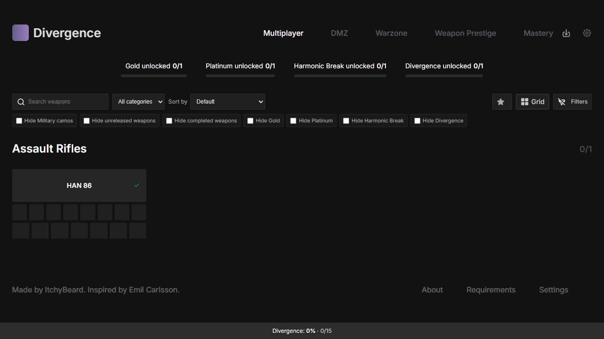
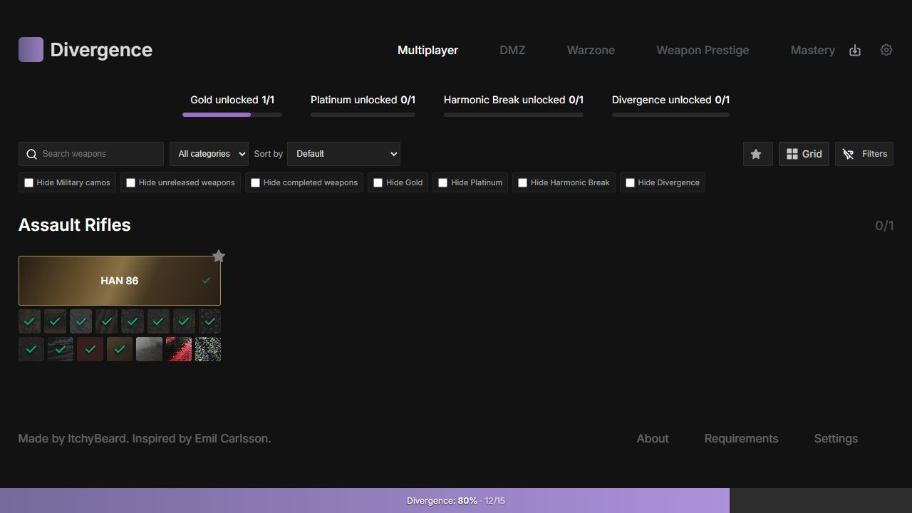
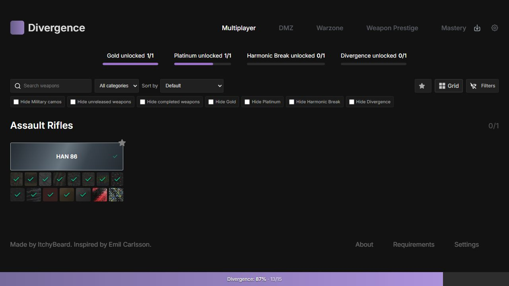
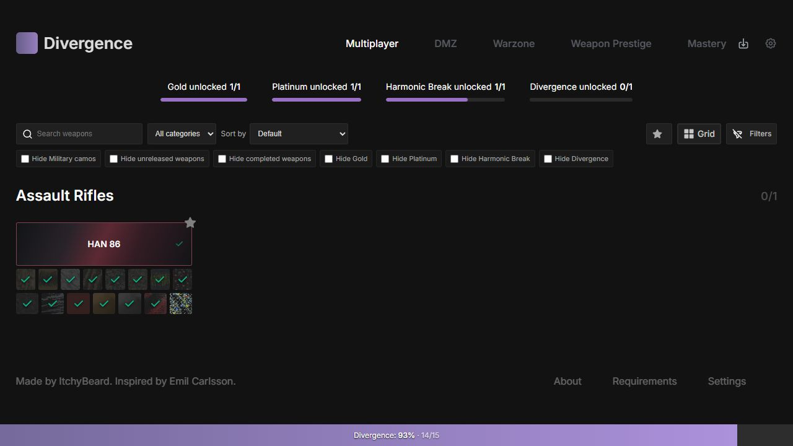
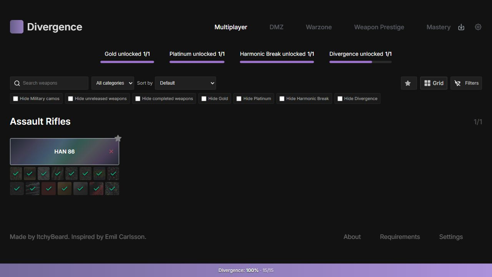
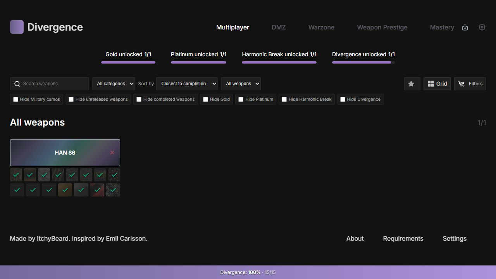
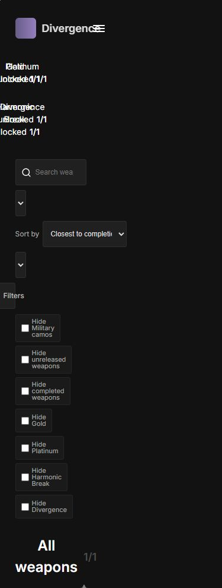
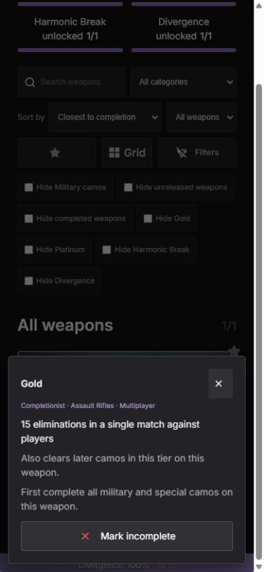

# Milestone 4 — Completion gradients, smart sorting and sequential shortcuts

Weapon headers now derive their tier directly from the existing shared flags:
Divergence > Harmonic Break > Platinum > Gold > Default. Nothing is saved for
appearance. The styles are static CSS gradients with inset borders so no tier
changes card dimensions. Prestige and mode mastery cannot change the tier.
White weapon labels retain contrast over the muted metallic highlights; the
brightest gold and platinum stops have contrast ratios above 4.5:1.

Sorting adds Default, Closest to completion, Least completed, Name A–Z/Z–A and
Most recently released to the existing compact toolbar. Filters run before
sorting. Categories retain catalog order while their weapons are sorted within
them. Closest also offers All weapons, using the same cards/table and no second
catalog. Favourites and grid/list/table layouts retain the same sorted results.
Ties use stable catalog indices, not the incoming filtered array's position.

Closest ranks partial weapons by descending applicable shared percentage, then
untouched, then fully complete. Unreleased weapons and weapons with no applicable
camos follow those groups and never enter completion calculations. Least ranks
ascending percentage, with unreleased/no-applicable entries last. The denominator
comes from the selected mode's projected available shared camo definitions,
including defined awards; unknown challenge flags do not inflate it. This means
ranking can differ between modes with different published requirements. The
existing global shared percentage is unchanged. Prestige-tab sorting also uses
shared camo progress, never Prestige or mode mastery completion.

Release sorting puts known released weapons first (newest date first), then known
upcoming/delayed weapons, then unknown dates. Dates are never invented. Within
these groups ties use catalog order. The optional All weapons preference applies
only to Closest and is retained when temporarily selecting another sort.

Sequential shortcuts are planned centrally before a single store patch and a
single persistence write:

- Military keeps its prefix-complete/suffix-reset behaviour.
- Direct Special clicks remain independent.
- Incomplete Completionist clicks complete all Military/Special camos and the
  Completionist prefix on that weapon. Reset clears only the Completionist suffix.
- Prestige clicks use their own four-stage prefix/suffix, without touching shared
  progress, mode mastery or any other weapon.
- New prefixes requiring any unpublished stage are blocked atomically, with a
  dismissible status message naming the unavailable stages. Requirements popovers
  explain the shortcut. Already completed unavailable flags can still be undone.
  Existing flags are never normalised on loading or inferred from player level.

Version 1 saves gain optional preferences `sortBy` and `weaponGrouping` in the
existing namespace. Missing preferences default to the original category/catalog
order. Import/export round-trip them; progress reset keeps them with other existing
preferences. No new storage keys or header/progression flags were introduced.
No Singularity data, weapon data, unlock conditions or artwork filenames changed.

## Files changed

Runtime:

- `src/data/mw4/tracker.js` — pure header, applicable-count, sort and toggle-plan helpers.
- `src/data/mw4/save.js` — additive, validated sorting preferences.
- `src/stores/store.js` — sorting projections, shared tier, atomic sequential actions and status feedback.
- `src/components/WeaponName.vue` — reactive header classes and gradients, visible focus treatment.
- `src/components/FiltersComponent.vue` — compact sort/grouping dropdowns and responsive wrapping.
- `src/components/WeaponsComponent.vue` — category-preserving/global presentation of filtered sorting.
- `src/components/CamoButton.vue` — shortcut explanation in existing tooltips/popovers.
- `src/App.vue` — accessible unavailable-sequence feedback.

Tests and documentation:

- `src/data/mw4/__tests__/tracker.spec.js`
- `src/stores/__tests__/store.spec.js`
- `src/components/__tests__/sorting.spec.js`
- `src/components/__tests__/tracker.spec.js`
- `src/data/weapons/README.md`, `README.md`, and this report.
- `docs/screenshots/milestone-4/*.jpg` — browser captures, not product artwork.

## Verification

- Full suite: **144 tests passed** across seven files.
- Data tests: **80 tests passed** across three files.
- Repository-wide ESLint: passed.
- Production build: passed.

Browser checks used the local tracker with its real HAN 86 entry:

- All five header tiers, live prefix completion and suffix fallback/reset.
- Sorting/grouping controls at desktop width and 390px/320px mobile viewports.
- No horizontal page overflow at those mobile widths; fixed bottom bar confirmed
  at the viewport bottom, with existing content padding retained.
- Refresh retained Closest and All weapons preferences and shared flags.
- Mobile tap opened requirements without changing completion; explicit completion
  and reset controls changed the intended flags.
- Warzone's unavailable prefix was blocked with a visible explanation and 0% unchanged.
- Browser viewport override reset when checks finished; test shared progress returned
  to its initial zero completion. No deployment performed.

The live catalog still has only HAN 86. Sorting multiple weapons across categories
is covered by test-only synthetic fixtures, never fabricated production weapons.
No feature in this milestone requires additional game data. The release grouping
and selected-mode sorting denominator above are the implementation assumptions.

## Screenshots

| Default | Gold | Platinum |
|---|---|---|
|  |  |  |

| Harmonic Break | Divergence |
|---|---|
|  |  |

