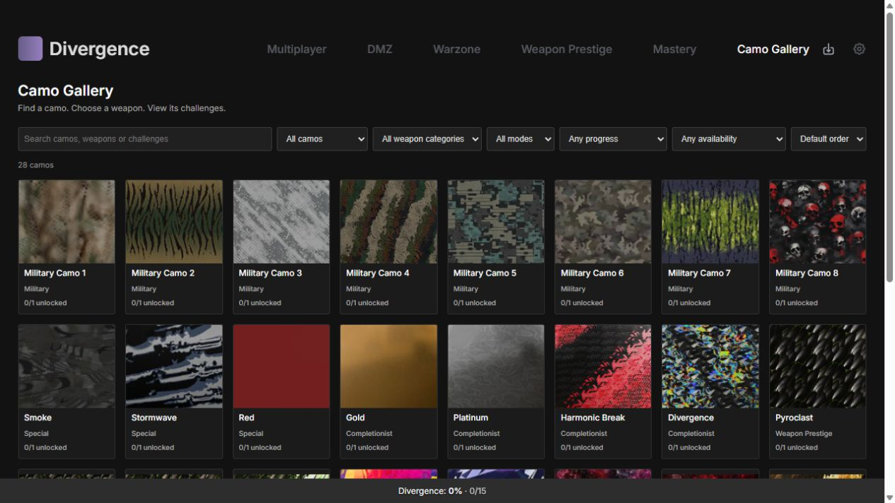
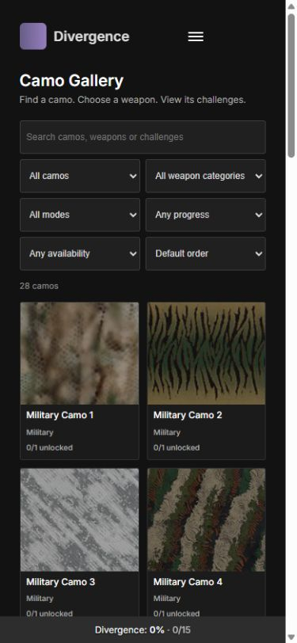
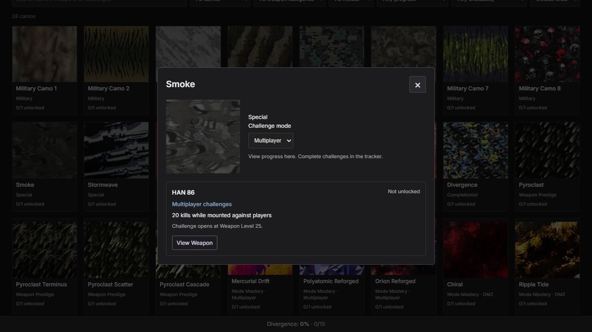
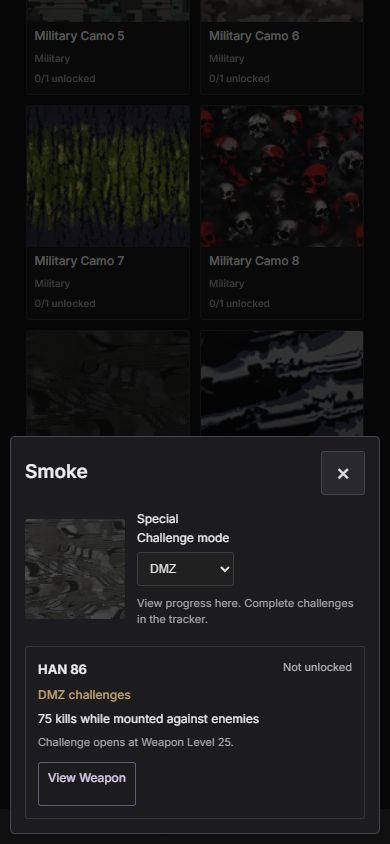
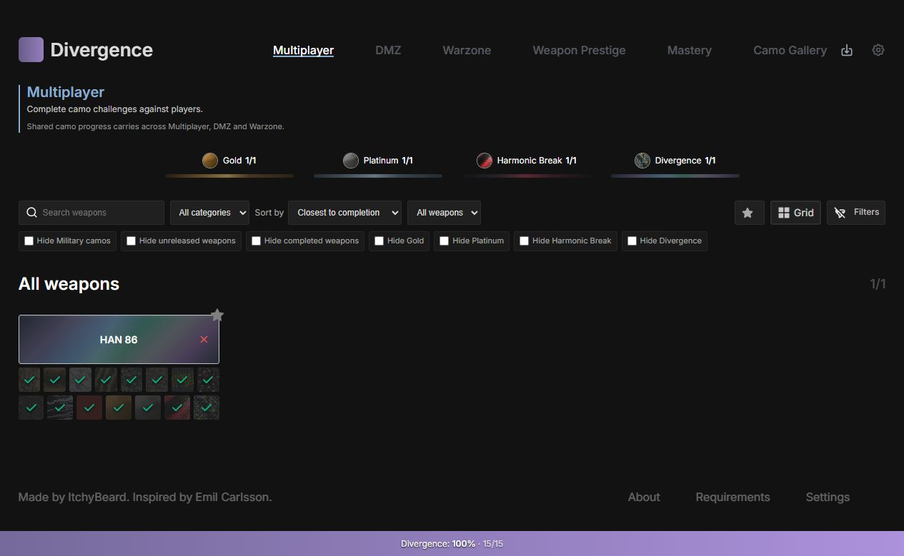
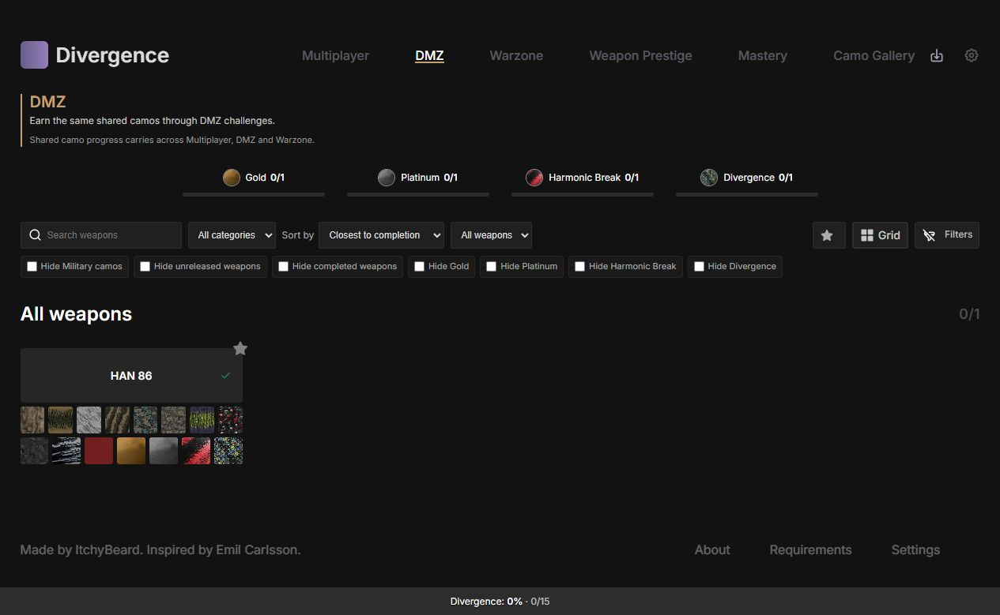
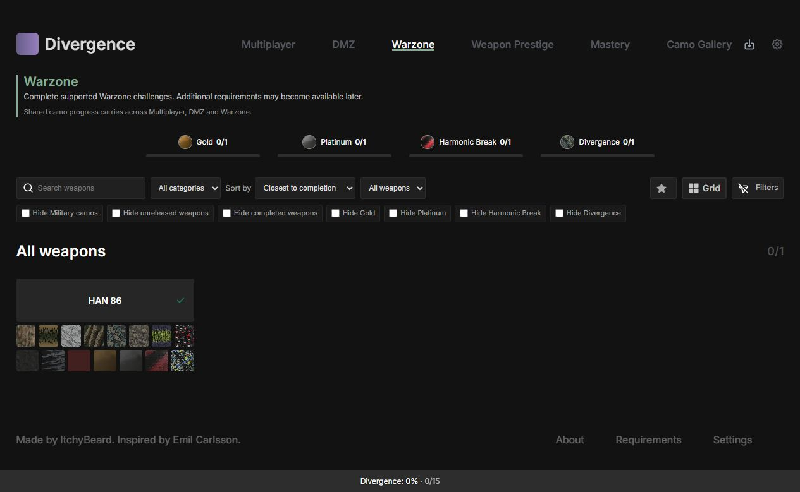
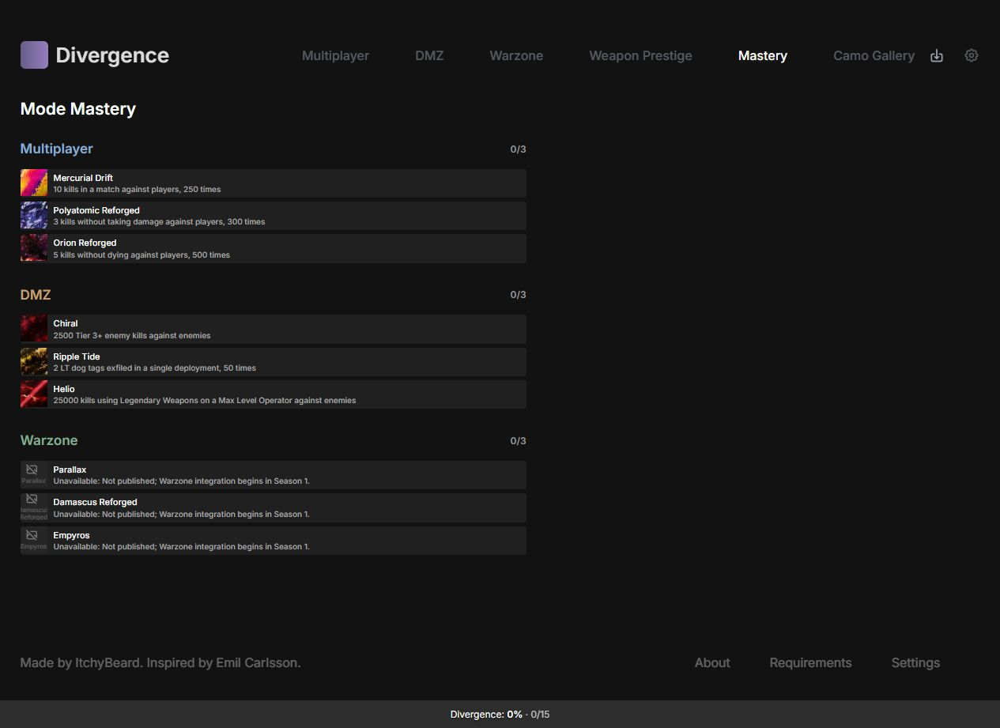

# Milestone 5 — Camo Gallery and visual progression

## Delivered

The new `/gallery` route is linked from desktop and mobile navigation. It derives
28 known designs from the discovered catalog and shared/Prestige/mastery definitions.
It is read-only: there are no Gallery progress flags, save keys or completion actions.
Canonical artwork references within a camo stage identify shared designs; stable
IDs distinguish missing-art designs. Equal display names with different artwork
remain distinct. Explicit aliases sharing artwork retain their own weapon/camo IDs
for reading progress and jumping to the tracker.

Filters combine stage, weapon category, game mode, progress, availability and search.
Search covers camo names, weapon names, category names, documented requirements and
prerequisites. Records are projected once when the page mounts; filtering uses the
precomputed requirement text. Gallery thumbnails reuse the existing lazy-loaded
CamoImage component and neutral missing-image fallback. No new image service or
unverified thumbnail filename convention was introduced.

Shared designs show a count of individual tracked unlocks, with each associated
weapon's state and requirements in an accessible detail dialog. Mode mastery reads
its existing account/mode flags. Prestige reads its existing weapon-scoped map.
The mode selector compares requirements without changing any progress. Keyboard
focus enters the dialog, stays inside on Tab/Shift+Tab, returns to its tile on
close, and supports Escape. Touch uses the same explicit read-only details.

View Weapon uses the existing tracker routes plus stable weapon/camo query IDs.
It opens the selected game mode (or Prestige), scrolls to the target and briefly
outlines it. A hidden target is temporarily revealed without modifying saved search,
category, favourite or visibility filters. Grid, list and table layouts are covered.
Upcoming weapons stay locked. Mastery links jump to the existing mode section.
Reduced-motion settings select immediate scrolling; the highlight is static.

Completionist milestones now have circular official artwork, compact counts and
thin bars. The Milestone 4 gradients were extracted unchanged to shared CSS tokens
used by both headers and bars. Progress fills and ARIA percentages update reactively.
Milestone totals exclude unreleased weapons and camos with no published requirement
in any mode. A documented award remains applicable under the existing award rule.
This union of published requirements keeps the four shared counts identical across
MP/DMZ/Warzone. It does not change the overall shared percentage or save semantics.
Bar transitions are disabled for reduced-motion users.

Tracker pages now show a compact mode heading, context and one shared-progress note.
Blue Multiplayer, muted amber DMZ and muted green Warzone accents appear in headings,
active navigation indicators and explicit challenge labels. Camo artwork and the
Completionist gradients retain their own colours. The Gallery detail selector and
existing tooltips show the chosen mode's requirements, including unpublished states.
Mastery rows retain the existing completion overlays and tap controls. A scoped
section selector removes an inherited margin that had also applied to each row.

## Artwork verification — 24 October 2026

The following canonical URLs returned HTTP 200 with image/png and a valid PNG
signature. All six were also decoded successfully in the browser on the Mastery page:

- `mercurial-drift.png`
- `polyatomic-reforged.png`
- `orion-reforged.png`
- `chiral.png`
- `ripple-tide.png`
- `helio.png`

The following expected filenames returned HTTP 404:

- `parallax.png`
- `damascus-reforged.png`
- `empyros.png`

All paths use `https://cdn.itchy-beard.co.uk/divergence/camouflages/` through the
existing resolver. The three missing Mastery identities stay on the neutral fallback
via a central missing-art list; once supplied they need re-verification and removal
from that list. No alternative filename was verified and no unrelated artwork was
substituted. Unpublished Warzone requirements were not changed or invented.

## Preserved external drafts

During implementation, 32 incomplete weapon definitions appeared in the shared
workspace. They failed strict validation because max/Special levels were unknown.
With the user's explicit approval, only invalid files were moved, byte-for-byte,
into [incomplete-weapon-drafts](incomplete-weapon-drafts/README.md). The
[validation manifest](incomplete-weapon-drafts/validation.json) records every original
path, preserved path and validation error. The externally replaced weapon README
and extraction metadata were left intact. No validation rule was weakened, no
unknown number was filled in, and no discovery exclusion/registration list was added.
Valid definitions remain automatically discovered. HAN 86 is currently the only
valid production entry. Unknown saved weapon IDs are still retained by the existing
version 1 save contract; moving drafts did not discard progress.

## Verification

- Full suite: **169 tests passed** across 10 files.
- Data suite: **91 tests passed** across four files.
- Repository-wide ESLint: passed.
- Production build: passed, with no chunk-size warning in the final build.
- No deployment or publishing performed.

Automated checks cover canonical deduplication, shared designs across synthetic
weapons, distinct equal-name designs, artwork aliases, combined filters/search,
selected-mode requirements, shared versus Prestige/mastery flags, unknown Warzone
requirements, release dates/unknown/delayed availability, Gallery read-only behaviour,
modal focus handling and Gallery-to-tracker jumps in grid/list/table layouts.
The existing v1 save, import/export/reset, sequential shortcuts, gradients, sorting
and legacy-storage-isolation tests remain passing. Completionist tests cover genuinely
unpublished requirements and unreleased imported flags being excluded from counts.

Browser checks used the live catalog at 1280px desktop and 390px/320px mobile widths:

- Responsive Gallery grid, filters, larger previews and detail mode comparison.
- All 25 resolvable Gallery images decoded; the three missing designs stay neutral.
- DMZ View Weapon jump highlighted Smoke and showed its 75-enemy mounted requirement.
- Mobile requirement viewing left shared progress at 0%; Warzone remained unavailable.
- Narrow detail dialog width 300px at a 320px viewport, with no horizontal overflow.
- Mobile Gallery page widths were no greater than the viewport; the fixed bottom
  progress bar remained fixed, and Mastery displayed six real images.
- Multiplayer blue heading/player context, DMZ amber heading/DMZ context, and Warzone
  green heading/published-availability context were all checked and captured.
- Completing/resetting HAN 86 updated all four milestone counts and fills immediately.
  Temporary browser test progress was reset to the starting zero completion.
- Browser viewport override was reset after testing. The Gallery is left open.

## Modified files

Runtime:

- `src/router/index.js`
- `src/views/GalleryView.vue` (new)
- `src/data/mw4/gallery.js` (new projection/search/navigation helpers)
- `src/data/mw4/modePresentation.js` (new presentation helper)
- `src/composables/useTrackerJump.js` (new)
- `src/data/mw4/artwork.js`
- `src/stores/store.js` (milestone applicability only; save actions unchanged)
- `src/views/HomeView.vue`
- `src/views/MasteryView.vue`
- `src/components/layout/NavigationComponent.vue`
- `src/components/layout/MobileNavigationComponent.vue`
- `src/components/OverallProgressComponent.vue`
- `src/components/WeaponName.vue`
- `src/components/WeaponsComponent.vue`
- `src/components/WeaponsTable.vue`
- `src/components/CamoButton.vue`
- `src/components/MasteryComponent.vue`
- `src/scss/main.scss`
- `src/scss/components/_progression.scss` (new shared palette)

Tests/documentation:

- `src/data/mw4/__tests__/gallery.spec.js` (new)
- `src/components/__tests__/gallery.spec.js` (new)
- `src/stores/__tests__/completionistStats.spec.js` (new)
- `src/components/__tests__/tracker.spec.js`
- `src/components/__tests__/camoDetails.spec.js`
- `README.md`, this report and `docs/screenshots/milestone-5/`.
- The 32 approved draft moves and their audit files are listed in the manifest above.

## Remaining limits

Three Warzone Mastery images are missing from the CDN, and Warzone requirements
remain unpublished where indicated by the existing definitions. The 32 preserved
weapon drafts still need verified values before returning to discovery. Multi-weapon
Gallery behaviour is tested with synthetic fixtures; no production weapons were
fabricated to populate the page. Gallery filters are session-local and deliberately
have no save structure. Progress filters mean "unlocked somewhere" or "still to
unlock": a shared design can satisfy both on different weapons. Available/upcoming
filters match any relevant association, while details retain all associated weapons.

## Screenshots

Additional narrow captures: [320px Gallery](screenshots/milestone-5/gallery-mobile-320.jpg),
[320px Warzone](screenshots/milestone-5/mode-warzone-mobile-320.jpg) and
[390px Mastery](screenshots/milestone-5/mastery-mobile-390.jpg).
